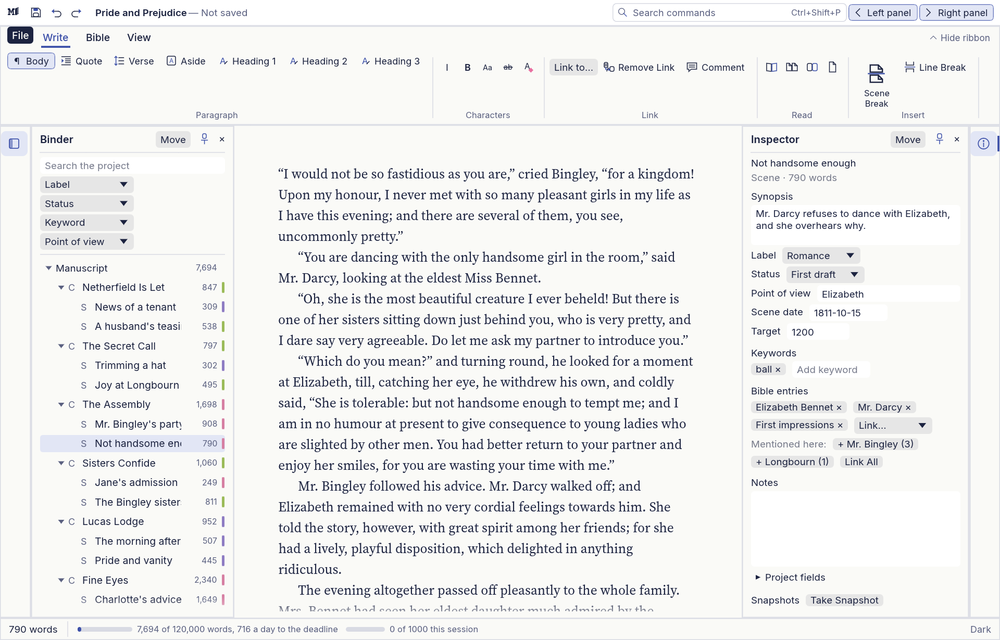
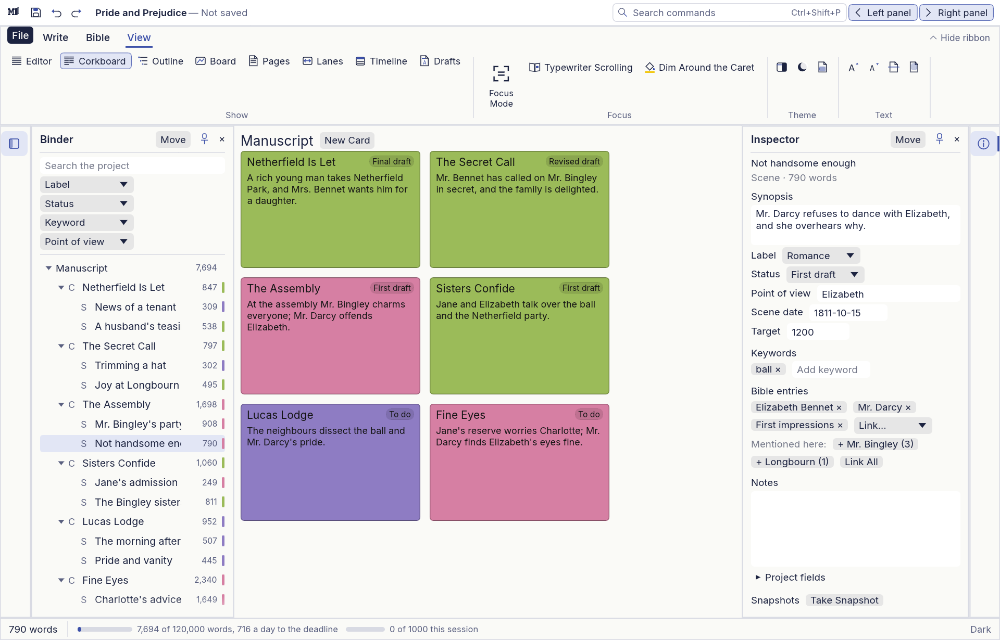
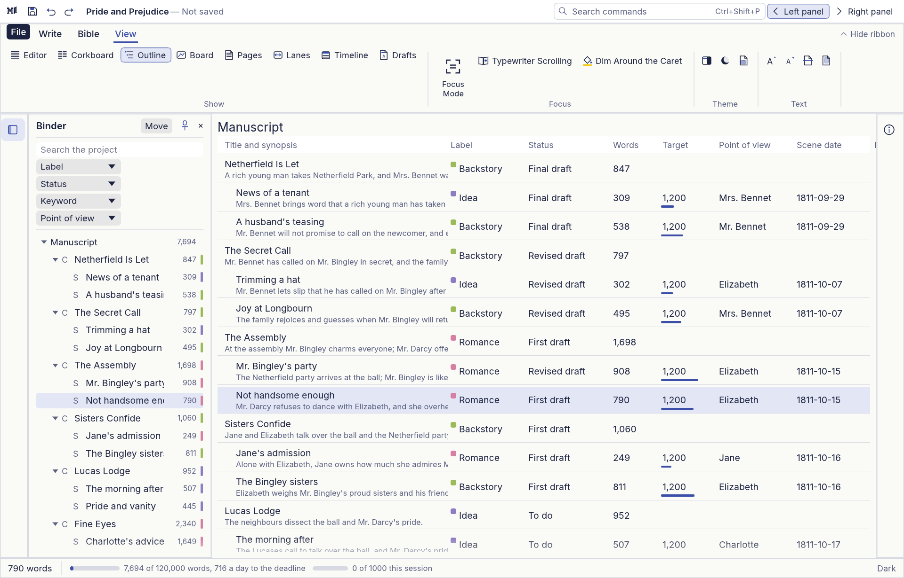
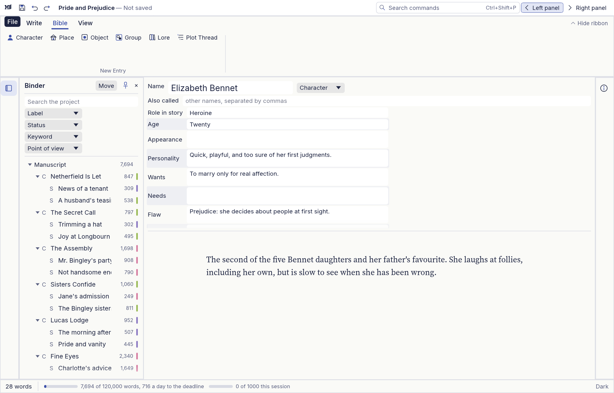
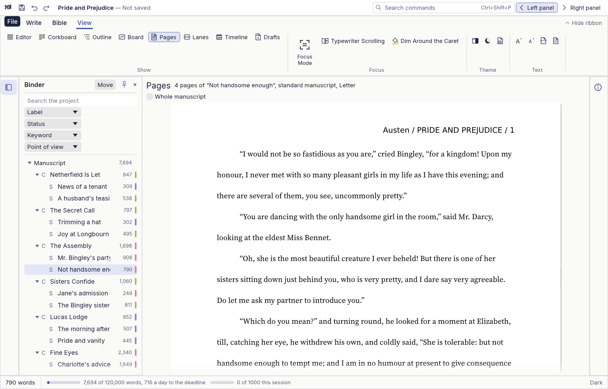
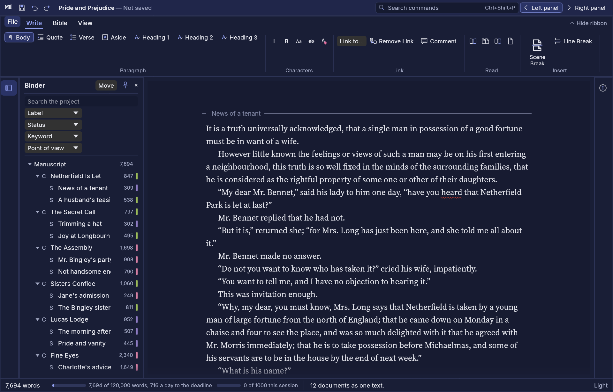

# Wordsmith Manuscript

Licensed under MIT OR Apache-2.0, at your option ([License](#license)).

An open-source app for writing novels and other long work, for macOS, Windows and Linux, written
in Rust. Keep the book as a binder of parts, chapters and scenes. Plan it on a corkboard and in an
outline, keep its people and places in a story bible beside the text, and watch your word targets
as you go. When it's done, hand an editor a standard manuscript, or pass the book to Wordsmith Book
to typeset. A project is a folder of plain-text files that read well in `git diff`, and nothing you
type is ever dropped or rewritten by saving, importing or exporting.



## What it does

- **Binder.** Parts, chapters, scenes and front and back matter in one tree, plus areas for the
  Story Bible, Research (pictures, PDFs and web links) and Notes, and a Trash that is emptied only
  when you ask. Drag to reorder, leave an item out of exports without deleting it, and bookmark
  the items you return to.
- **Writing.** Manuscript styles (body, block quote, verse, aside, scene break; italic, bold,
  small caps). Curly quotes and dashes for your language. Spelling that learns your characters'
  names, and grammar hints if you turn them on. Find and replace across the whole project. Focus
  mode with typewriter scrolling. A split editor, and a stitched view that lets you edit a
  chapter, or the whole book, as one text.
- **Planning.** A corkboard of index cards, an outline you can sort and edit in place, a freeform
  board, thread lanes and a timeline of the story's own dates. Filter every view by label,
  status, keyword or point of view.
- **Story bible.** Characters, places, objects, groups, lore and plot threads, each with its own
  sheet. Link entries to the text, and see every scene that names an entry. Relationships between
  entries, your own entry types, and one bible shared by every book in a series.
- **Progress.** Live word counts, a manuscript target with a deadline and writing days, session
  and scene targets, and a writing history kept on your computer. Snapshots you can compare word
  by word, revision passes in color, and drafts you can keep side by side.
- **Files.** Import DOCX, ODT, RTF, Markdown, text, web pages, OPML outlines, EPUB books, folders
  of Markdown notes, and a folder of drafts as one set. Export a standard manuscript (DOCX and
  PDF), DOCX, ODT, RTF, Markdown, text, HTML, an EPUB reading copy, or a book package for
  Wordsmith Book. Every import and export is checked word for word. Auto-save, recovery after a
  crash, rotating backups, and conflict copies instead of silent overwrites in synced folders.
- **Automation.** `manuscript-cli` converts, exports, counts and verifies, and serves every
  command to agents over MCP.

The window has a ribbon of tabs (Write, Bible, View), a Binder on the left, an Inspector on the
right (synopsis, label, status, fields, target, keywords, bible entries, comments and snapshots),
a File page for new, open, import, export, targets and preferences, and a status bar with the
words written and how far the targets have come.

| | |
| --- | --- |
|  |  |
|  |  |



The app draws these pictures itself (`cargo xtask screenshots`) from the first six chapters of
*Pride and Prejudice* (1813), which is in the public domain. The chapter and scene titles,
synopses and bible entries were written for the pictures.

## Getting started

Read the [user guide](docs/guide/README.md). To build and run:

```sh
cargo run --release -p wordsmith-manuscript
```

`rust-toolchain.toml` names the exact Rust release the project builds and ships with (rustup
installs it on first use). The code also builds with Rust 1.95, the minimum supported version.
A first build needs network access to crates.io and to GitHub, where open-source-core and its
upstream libraries come from (pinned to exact releases). The command line:

```sh
cargo run --release -p wordsmith-manuscript-cli -- help
cargo run --release -p wordsmith-manuscript-cli -- convert draft.docx novel.wsm
cargo run --release -p wordsmith-manuscript-cli -- counts novel.wsm
```

`packaging/` holds the desktop entry and file types for Linux, the app bundle's `Info.plist` for
macOS and the file-type registration for Windows. `cargo xtask third-party-licenses` writes the
license text of every shipped dependency.

**Status:** 1.0 is prepared (see [CHANGELOG.md](CHANGELOG.md)) and waits for a maintainer to
approve the first release; no release has been published yet. The web version waits for the core
to support a web build.

### Checking a download

Release files come only from this repository's GitHub releases. Each one has a build provenance
attestation, which shows it was built from this repository by its release workflow. With the
GitHub CLI:

```sh
gh attestation verify wordsmith-manuscript-<version>-<target>.tar.gz --repo jamescjfoundation/wordsmith-manuscript
```

`SHA256SUMS.txt` on the same release lists every file's checksum.

## Privacy

- **No telemetry.** The app does not report usage, crashes or anything else.
- **Your writing stays on your computer.** Your text, notes, bible and file names are never sent
  anywhere. The writing history is kept in the app's settings folder, never in the project.
- **The update check** is the only request that leaves your computer. When the app starts, and
  when you choose Check for Updates, it asks GitHub's API (`api.github.com`) for this
  repository's list of releases. GitHub sees your IP address and a user agent that names the app
  and its version, nothing else. An update is downloaded only when you choose to install it,
  from the release on github.com.
- **Turning it off:** clear "Check for updates when the app starts" in File › Preferences.
  Nothing is sent unless you then check by hand. `manuscript-cli` never checks.
- **External converters** run only when you name one yourself in the export settings, and only on
  your computer.

## Working on it

Read [CONTRIBUTING.md](CONTRIBUTING.md) first: this repository is public, and it sets the rules
for personal information, security problems, names and copied code. Report security problems
privately, as [SECURITY.md](SECURITY.md) says.

The app is built on
[open-source-core](https://github.com/jamescjfoundation/open-source-core), the J. C. J.
Foundation's shared base for its desktop apps. The document model, layout, PDF, the command
engine, document import and export, spelling and grammar, the window around the text (ribbon,
panels, File page, preferences, updates), cards and boards, the general story-bible layer and the
agent server all come from its `jcj-` crates. This repository holds what is about long-form
writing: the binder and its roles, the project format, the stitched view, the corkboard, outline,
lanes and timeline, the story bible's types, compile and the standard manuscript, import mapping
and the hand-off to Wordsmith Book. `AGENTS.md` says how a change that belongs in the core is
made, how the Wordsmith repositories fit together, and what Wordsmith Book relies on here.

Before anything goes to `main`, run the gate:

```sh
cargo xtask ci
```

It runs rustfmt, the crate-root lint check, a check that no local core link is left, a check that
every core dependency names one release (`cargo xtask core-pin`), a check that the files and rules
shared with the core match the pinned core release (`cargo xtask sync --check`), the layers checks (no upstream crate is named here, and each Manuscript crate uses only the layers
under it), the asset attribution check, the privacy check, the license allowlist, clippy and all
tests. CI also runs [cargo-deny](https://github.com/EmbarkStudios/cargo-deny) for licenses,
security advisories and crate sources.

- `docs/PLAN.md`: the build plan. `docs/SPEC.md`: the behavior it was built from.
- `docs/format.md`: the project format. `docs/book-handoff.md`: what Wordsmith Book reads.
- `docs/decisions/`: the choices the spec left open.
- `docs/golden.md`: the reviewed reference outputs. `docs/fixtures.md`: where every test file
  comes from.
- `docs/progress.md`: one line per finished step. `CHANGELOG.md`: what changed.

## Acknowledgments

Wordsmith Manuscript is based on WordCraft by the ArtCraft team. Its document model, page layout,
drawing, PDF output, font handling, command engine and agent connection are WordCraft's, through
[open-source-core](https://github.com/jamescjfoundation/open-source-core); the core's
`docs/UPSTREAM.md` says how.

It is also built on these open-source projects:

- [craft-libs](https://github.com/storytold/craft-libs): spelling and grammar, PDF reading and
  writing, file dialogs, safe saving and the update check.
- [egui and eframe](https://github.com/emilk/egui) for the window and its controls, with
  [AccessKit](https://github.com/AccessKit/accesskit) for screen readers.
- [HarfRust](https://github.com/harfbuzz/harfrust) and
  [Skrifa](https://github.com/googlefonts/fontations) for shaping and reading fonts,
  [Vello CPU](https://github.com/linebender/vello) and
  [kurbo](https://github.com/linebender/kurbo) for drawing, and unicode-bidi,
  unicode-linebreak and unicode-segmentation for bidirectional text and line breaking.
- [zip](https://github.com/zip-rs/zip2) and [quick-xml](https://github.com/tafia/quick-xml) for
  the packed project and the document formats, and [regex](https://github.com/rust-lang/regex)
  for find and replace.
- The fonts: [Source Serif 4](https://github.com/adobe-fonts/source-serif) for the text, and
  [Inter](https://github.com/rsms/inter) and
  [JetBrains Mono](https://github.com/JetBrains/JetBrainsMono) for the interface, all under the
  SIL Open Font License.
- [Wordsmith Script](https://github.com/jamescjfoundation/wordsmith-script), the foundation's
  screenwriting app, whose file format Manuscript reads for screenplays in a project.
- Project Gutenberg, for the public-domain novels the tests and pictures use.

`ATTRIBUTION.md` lists every asset with its license, and `NOTICE` carries the notices the
licenses ask for. `cargo xtask third-party-licenses` writes the license text of every library a
release ships.

## License

Licensed under either of Apache License, Version 2.0 (`LICENSE-APACHE`) or the MIT license
(`LICENSE-MIT`), at your option. Third-party credits are under [Acknowledgments](#acknowledgments).
