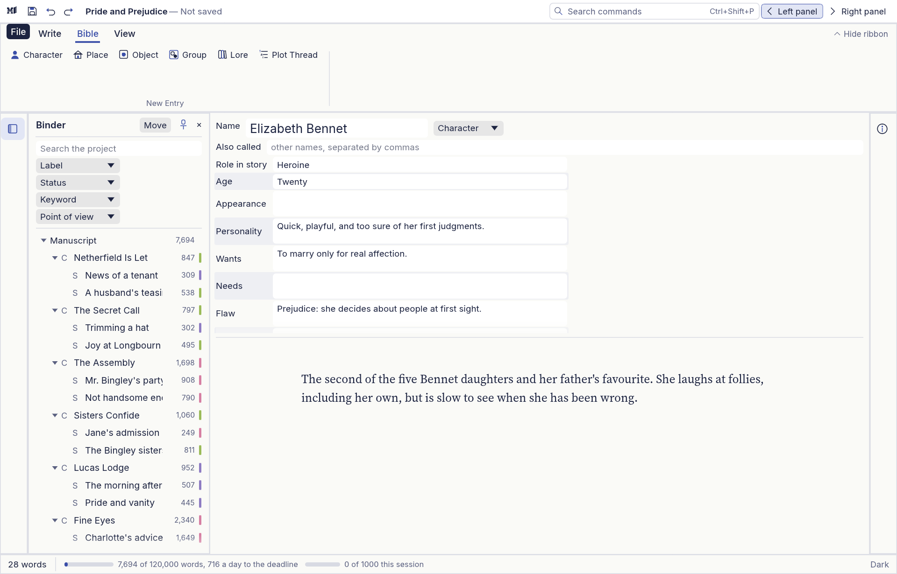

# The story bible

The Story Bible area holds entries: characters, places, objects, groups, lore and plot threads.
Each type has a template of fields (a character has a role in the story, age, appearance,
personality, wants, needs, flaw and history), and every entry also has aliases and a free body.

- **New entries**: the Bible tab, or right-click the Story Bible area. An entry goes in its type's
  folder.
- **The entry view**: name, type, aliases and fields at the top; the body below, in the editor.
  Add a field of your own with Add a field.
- **Backlinks**: each entry lists the documents that link to it and those that mention its name or
  an alias without a link.
- **Links**: link words in the text to an entry with Write › Link to….
- **Spelling** accepts every entry's name and aliases.

## Importing a notes folder

File › Import › Notes Folder into the Story Bible takes a folder of Markdown notes: each note
becomes an entry named after its file; front matter (`aliases`, `type`, any other field) becomes
its aliases, type and fields; `[[Name]]` and `[[Name|text]]` become links. A link to a name no
entry has keeps its text and is listed in the report. Subfolders become bible folders.

## Your own entry types

Right-click Story Bible › Entry Types… (or Entry Types in the command palette) to change what each
type of entry asks for, or to add a type of your own: ships, spells, songs, anything your story
keeps track of. Name a field, choose what it holds (text, long text, a list, a picture, a link to
another entry), move it up or remove it, then Save Type. Renaming a field keeps every entry's value
under the new name. Removing a field never removes what you wrote: an entry's values for fields
its type no longer has stay with it, after the type's fields. A changed default type can go back
to the default; a type of your own can be removed once no entry uses it.

## A series

Books of a series can share one Story Bible. In the command palette run Series, give the series a
name and a folder for its bible, and Start a Series: this book's bible moves into that folder.
Open the next book, run Series, give the same folder and Join a Series: its own entries join the
series' and it sees all of them. Every book of the series now reads and writes the same entries;
what one book saves appears in the others (the status bar says so), and if two books change the
same entry at once, both versions are kept. The Series window lists the books with Open buttons.
Leave the Series keeps a copy of the bible in the book as its own.

## Relationships

An entry's Relationships section says how it stands to other entries: sibling of, married to,
friend of, rival of, parent of, works for, member of, lives in, owns, part of. Choose the relation
and the other entry, then Relate. The other entry shows it too, read its way ("child of" for
"parent of", "employs" for "works for"). Relations of your own wording can be added with
`entry.relate`. × removes a relation from either side.
