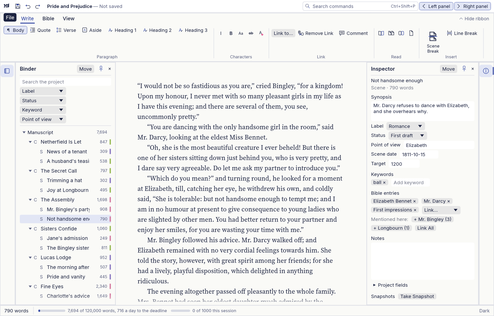

# Getting started

## A new project

When no project is open, the start window shows the templates, Open, and recent projects.

- **Novel**: front matter with a title page, Part One with Chapter One and Scene One, story bible
  folders (Characters, Places, Objects, Groups, Lore, Plot Threads) and notes for the premise and
  synopsis.
- **Short story collection**: a title page and a contents page, Story One with a scene, the same
  bible and notes.
- **Your templates**: Save as Template ([the command palette](#the-command-palette)) keeps the open project's shape as a
  template of your own: its binder, labels, statuses, keywords, fields, entry types, targets and
  export settings, every item's synopsis and notes, and the text of front matter, back matter,
  notes and research. The book's own chapters and scenes stay empty, and its bible entries,
  pictures, comments and snapshots are not kept. Your templates live on this computer, beside the
  app's preferences, and appear under Your Templates; each new project made from one is its own.

Picking a template makes a new project folder in your Documents folder (File › New lets you choose
where). A project is a folder ending in `.wsm`; you can also open its `project.toml`, or a packed
project (`.wsmz`), which is unpacked into a folder beside it.

## The window

- **The binder** on the left: the project's items in five areas (Manuscript, Story Bible,
  Research, Notes, Trash).
- **The editor** in the middle: the selected document's text. The View tab switches it to the
  corkboard or the outline.
- **The inspector** on the right: the selected item's synopsis, label, status, keywords, linked
  bible entries, target, notes and snapshots.
- **The status bar**: the document's words, the selection's, the manuscript's progress toward its
  target, and this session's words.

## The command palette

Every command of the app is in the command palette, and some are only there: Save as Template,
Series, Entry Types, Interface Language, Start Revision Pass, Grammar Hints, Offered Fixes.

- Press Mod+Shift+P (Ctrl+Shift+P, or Shift+Command+P on a Mac), or click the Search commands
  box at the top of the window.
- Type a few letters of the command's name and choose it from the list.
- File › Keys gives any command a key of your own, the palette's included; [Keys](keys.md)
  lists the defaults.

## Your first words

Select Scene One in the binder and type. Your work is saved automatically; File › Save (Mod+S)
saves at once. Mod+Alt+N adds a new document after the selected one.

## Screen readers

The window works with screen readers through the system's accessibility interface. Every button,
field, binder row, card and table cell has a name. The editor reads as a text field named after
the document ("Text of “Scene One”"); its value is the paragraph with the caret, with its kind when
it is not body text ("Quote: …", "Heading 1: …"), and the caret and selection are reported as you
move. In a text read as one, each document's title line reads as "Document: …". Every command is
also in the command palette and can be given a key (File › Keys).

## Interface language

The interface follows your computer's language when it comes in it, and English otherwise. To
choose, run Interface Language in the command palette (Interface Language: English, Interface
Language: Español). One language holds for the whole window: the commands, the ribbon, the panels
and the windows, and also the File page, Preferences, the dialogs and the command palette.
Anything not translated yet shows in English. Your text, its language and its spelling are separate: they
follow the project's language (File › Book Details).
