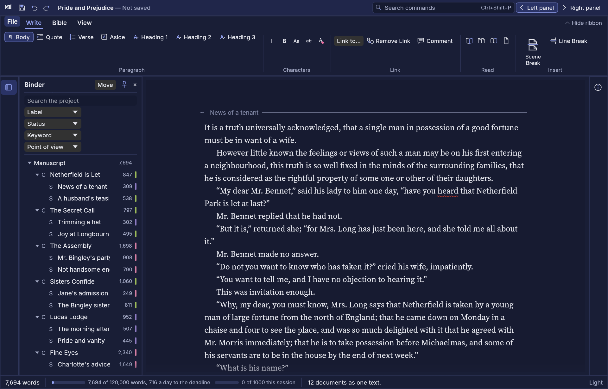
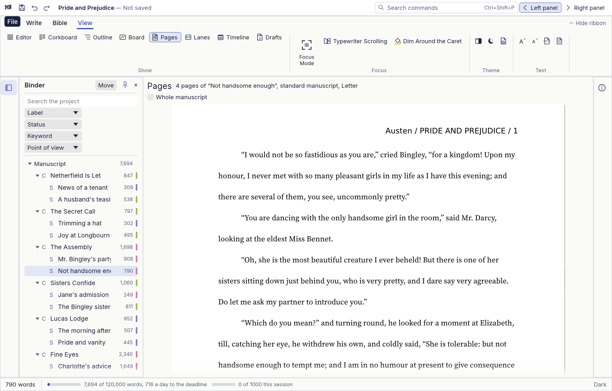

# Writing

## Styles

The Write tab offers only styles a manuscript needs; the file format keeps every one of them.

| Paragraphs | Characters |
| --- | --- |
| Body, Block quote, Verse, Aside (letter, note, message...), Heading 1 to 3 (for front matter pages), Scene break | Italic (Mod+I), Bold (Mod+B), Small caps, Strikethrough, Language, Plain |

The first paragraph after a heading or a scene break is shown without its indent, as books set it.
Pasted text comes in as plain text, one paragraph per line, so no stray fonts or colors get in.

**Scene breaks** (Mod+Shift+Enter) are paragraphs of their own; exports print them with the
symbol you choose.

## Smart typing

As you type, straight quotes become curly quotes for the project's language (English “ ”,
German „ “, French « » and others), two hyphens become an em dash, a spaced hyphen an en dash,
three periods an ellipsis. Backspace right after a change puts back what you typed. Switch each
rule off, or set the project's language, with the `settings.typing` command (or ask an agent).

## Reading several documents as one

Read as One Text (Mod+Alt+R) opens the selected chapter or part, with everything under it, as one
continuous text; Read the Whole Manuscript does the same for the whole book. A line with each
document's title separates them. Edit freely: each document gets its own words back when the
project is saved. A paragraph you type at the end of a document belongs to it; documents are never
merged or lost, even when you select across a divider and type.

## Two panes

View › Split (Mod+Alt+\\) shows two editors side by side; Split Top and Bottom stacks them. Each pane
holds a document or a text read as one. Click a pane, its tab or press Mod+Alt+O to make it the
active one: the binder opens documents there. A document is editable in one pane at a time; if the
other pane already holds it (alone, or inside a text read as one), it opens read-only and shows the
other pane's changes when you come back to it. One Pane, or a tab's close button, goes back to one.

## Pages

View › Pages (Mod+5) shows the selected chapter or scene, or with Whole manuscript ticked the whole
book with its title page, as standard manuscript pages: laid out exactly as the PDF export lays
them out, with the page count above. The pages follow your writing (they are laid out again in the
background after each change); write in the editor and come back to see them.

## Revision passes

When you start a round of revision, run Start Revision Pass (command palette, or ask an agent): the
pass gets the next color, and from then on what you type or paste shows in that color. Revision
Mode (Mod+Shift+E) turns marking off and on; text you type next to marked text while it is off is
not marked. `revision.list` shows the passes and how many documents carry each; Clear Revision
Marks takes one pass's marks (or all) off the text and leaves every word. The marks are saved with
the text and never exported.

## Comments

Select some words and choose Add Comment (Mod+Alt+M): the words get a soft highlight and the
comment opens in the inspector to write. The inspector lists the document's comments in text
order; Remove takes a comment away and leaves the words exactly as they were. Exports leave
comments out unless you tick "Comments as review comments", which makes them real comments in
DOCX, ODT and RTF files for an editor to answer.

## Find and replace

Mod+F opens the find bar. Find in the document, the selection or the whole project, with match
case, whole word, and patterns (regular expressions with `$1` groups in the replacement). Replace
All in the project first takes a snapshot of every document it changes.

## Spelling

Misspelled words get a wavy line; right-click one for suggestions, Add to Project Words, or Ignore
All. Every bible entry's name and aliases count as words.

**Grammar hints** are off until you turn them on (View › Grammar Hints, in the command palette).
Then words a grammar or style rule questions get a dotted blue line; right-click for what the
rule says, a replacement, or Ignore. The check runs on this computer; nothing is sent anywhere.
Hints are suggestions only: nothing changes unless you pick a replacement.

## Links

Select words and use Write › Link to… (Mod+K) to link them to a bible entry or a document. Hover
over a link to see what it points at; command-click to go there.

## Focus

Focus mode (F11) shows the text alone, full screen, keeping the line you type at the same height.
Escape leaves. The View tab also has typewriter scrolling, a sepia page, light and dark themes, and
the text size and column width (which never change exports).

## Drafts

View › Drafts lists the draft you are writing and the drafts you have kept. **New Draft** keeps the
manuscript exactly as it is now under its current name ("First Draft") and you carry on writing
the new one ("Second Draft") in the binder; notes, research and the story bible are shared by all
drafts. **Compare** shows a kept draft beside the one you are writing, chapter by chapter and
scene by scene: what was added, cut or changed, with the words. **Write This** makes a kept draft
the one you write again (the other is kept in its place). **Export This** chooses the draft File ›
Export writes and Wordsmith Book typesets. Importing a set of documents with several drafts makes
the latest the one you write and keeps the earlier ones as drafts.
